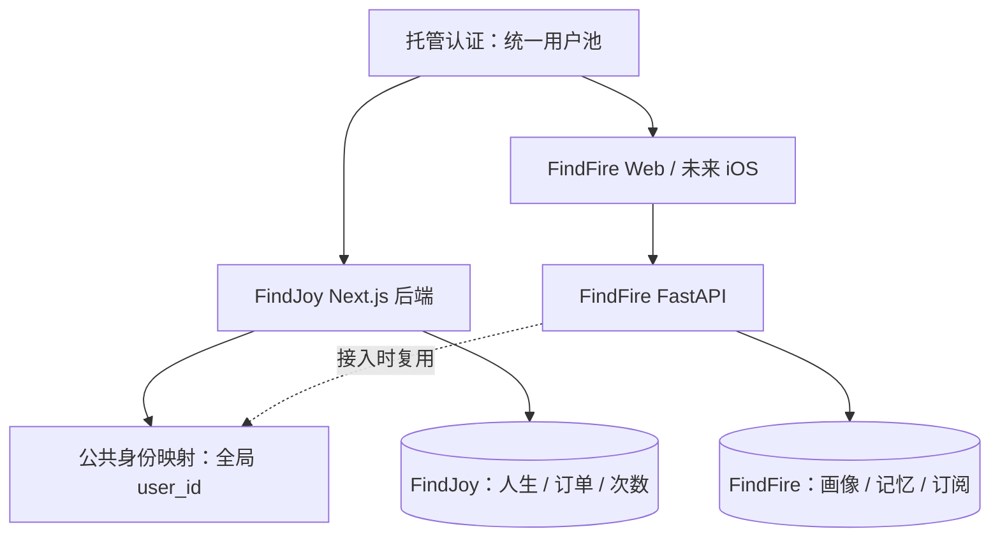

# FindJoy / FindFire 产品关联与统一身份协作约定

更新日期：2026-11-01。状态：产品方向与架构建议；统一账号和商业化能力尚未实现。

## 1. 文档职责与同步方式

本文件用于两个仓库同步开发时理解产品关系、身份边界和迁移约束，不代替各产品自己的需求文档，也不代表其中建议已获实施批准。

- 主文档：`findjoy/docs/development/findjoy-findfire-shared-identity.md`。
- 同步副本：`findfire/docs/development/findjoy-findfire-shared-identity.md`，内容应与主文档一致。
- 两边 `AGENTS.md` 均引用本仓库内的副本，单独克隆一个仓库时仍可阅读。
- 同时有两个仓库时：修改主文档后同步副本，检查两者一致；分别查看 Git diff，不自动提交或发布。
- 只有 FindFire 仓库时：可以记录必要变更，但须说明主文档尚未同步；下次两仓库可用时先核对差异，不盲目覆盖。
- 任何身份标识、登录协议、账号绑定、权益语义、跨产品数据访问或部署路由的变化，都需同步本文件。产品内部 UI、模型和算法变化无需机械同步。
- 后续 AI 开始相关任务前先读本文件，再读涉及仓库的实际代码；向 owner 说明现状或建议发生的变化。遇到冲突先报告，不把规划当成已上线能力。

## 创业资源约束与技术选型优先级

Owner 当前是单人创业，开发、运营与商业化均需自己承担；有限时间优先投入营销和产品迭代。技术目标是敏捷交付与低维护，而非最大控制权或最低软件账单。

- 默认优先成熟托管服务、现有能力与最小实现；按开发时间、持续运维、故障处理、接入费用一起比较总成本。
- 不因 owner 有部署能力就推荐自托管。只有托管方案无法满足已确认的需求，或总成本明显不合适时，才考虑自己维护基础设施，并明确新增负担。
- 当前统一身份优先验证托管认证（Authing 等）；Casdoor 自托管不作为默认首选。Owner 已指定 Authing；实施时须核验国内登录渠道准入、当前套餐、多应用身份和导出能力。
- 不为未来 SSO、规模化和多客户端提前建设；保持稳定身份边界，按实际产品进度扩展。
- 后续技术建议先给适合单人创业的默认选择及关键代价，避免无必要的选项堆叠。

## 2. 产品关系与非目标

FindJoy（觅乐）通过虚拟人生决策帮助用户探索想怎样生活，近期优先完成按体验次数付费的商业验证。
FindFire（觅火）通过现实活动、地点推荐与娱乐决策帮助用户发现生活乐趣，是长期核心产品，未来计划支持会员订阅、Web、iOS，仓库也预留小程序方向。

两个产品目前独立开发、部署、运营和收费；FindJoy 长期可成为 FindFire 生态中的板块，但不因此合并业务引擎或数据库。

共同原则：统一身份、独立业务、独立权益；先完成 FindJoy 商业闭环，再按真实需求扩展公共能力。

当前不做：微服务体系、统一运营平台、通用计费引擎、跨产品积分钱包、自动共享画像、一次性重写两套技术栈。

## 3. 已核实的代码现状

以下是本地仓库快照，不是线上环境审计。未读取真实环境密钥，未验证线上数据库、域名路由和部署状态。

| 项目 | FindJoy | FindFire |
| --- | --- | --- |
| Web | 根目录 Next.js 16.4.3 / React 19 / TypeScript | `apps/web`：Next.js 14.2.5 / React 18 / TypeScript |
| 后端 | Next.js `app/api`，SSE 人生事件 | `apps/api`：FastAPI，Web Route Handler 转发，Agent runtime |
| 持久化 | `better-sqlite3`，WAL，`lives` 和 `transcripts` 存 JSON | PostgreSQL 15 配置，psycopg；也有内存 store |
| 身份 | 无账号或服务端会话；localStorage 保存最近人生 ID | localStorage 保存 `findfire_user_id`；默认 `rocc`，不是正式认证 |
| 业务 | 一套 LifeState 和事件循环，普通/主题/剧本/ForU | 决策会话、运行记录、画像、偏好事实、记忆、反馈、搜索证据 |
| 支付 | 无订单、次数账本及支付回调 | 本次检查未发现正式订阅和计费模块 |
| 部署定义 | GitHub Actions → 腾讯云单机；systemd Next.js 3001；nginx `/findjoy` | GitHub Actions；Docker API 8003 / PostgreSQL 54323（回环绑定）；systemd Web 3003 |

### FindJoy 代码入口

- `package.json`、`next.config.ts`：版本、`basePath=/findjoy`。
- `lib/life-store.ts`：SQLite、全站历史和跨局查询、状态与 transcript 分开写入。
- `app/api/life/start/route.ts`、`app/api/life/[id]/{route.ts,next/route.ts,ending/route.ts}`、`app/api/lives/route.ts`：目前无用户鉴权与所有权校验。
- `lib/model-adapter.ts`：模型适配与 fallback；降级是否计费需要明确。
- `docs/product/mvp-product-spec-v0.1.md`、`docs/product/game-modes-v0.1.md`：产品规则。旧文档存在普通/主题免费定位，商业化实施前须与最新按次收费要求对齐。
- `DEPLOY.md`、`deploy.config.yml`、`deploy/deploy-production.sh`、`.github/workflows/deploy.yml`：部署定义。

### FindFire 代码入口与限制

- `apps/web/lib/auth.ts`：`OWNER_USER_ID="rocc"`，本地标记与 owner 登录方法，不能作为生产身份凭证。
- `apps/web/app/api/profile/route.ts`、`profile/onboarding/route.ts`：从请求读取 user_id，存在 `rocc` 默认值。
- `apps/api/app/main.py`：画像、会话、运行记录等接口，目前没有完整认证和对象所有权边界。CORS 不等于鉴权。
- `apps/api/app/persistence/postgres_store.py`：`stable_user_uuid()` 用固定 namespace 对传入标识做 UUIDv5，空值映射为 `anonymous`；现有 UUID 是产品内部映射，不是全局身份。
- `apps/api/app/persistence/factory.py`：无 DATABASE_URL 或 PostgreSQL 不可用时返回内存 store。正式保存用户数据与权益时必须报错/告警，不能静默退回易失存储。
- `apps/api/migrations/001_agent_os_schema.sql` 等：已有 UUID user_id 和画像/记忆结构，需增量迁移，不能删库重建。
- `README.md` 中仍有历史启动说明；部署以实际脚本为依据。未因为文档写有部署流程就推断线上已经部署。

## 4. 推荐身份架构（待实现）

采用支持标准 OIDC 的托管认证：统一用户池，FindJoy Web、FindFire Web、未来 iOS 分别注册客户端。Owner 已指定 Authing，FindJoy 已接入标准 OIDC + PKCE；真实验证码登录、短信包和生产配置仍待验证。小豆支付为指定支付渠道，商品价格先 mock。

认证供应商负责凭证、登录验证和标准授权流程；我们持有稳定的全局 UUID `user_id`，通过身份映射关联外部账号。业务不能直接以手机号、邮箱、`rocc` 或未经验证的请求 user_id 作为身份。

图表示逻辑边界。当前身份映射模块可随 FindJoy 单体部署；FindFire 正式接入前，把它提供为产品中立的公共身份能力，不让 FindFire 调用人生或次数接口完成登录。

不要求同数据库或同进程：FindJoy 可先保留 SQLite，FindFire 保留 PostgreSQL。若公共身份模块以后使用 PostgreSQL，也无需同时搬迁 FindJoy 人生数据。

### 身份与会话契约

- 全局 user_id 由受信服务端生成，永久稳定，不因更换手机号、认证厂商或客户端而改变。
- 外部身份按可信发行方及其主体命名空间唯一映射。验证不同客户端是否返回相同 subject；pairwise subject 必须通过供应商支持的可信关联方式映射，不能靠邮箱猜测。
- 每个产品使用独立客户端配置、令牌 audience 与会话。相同用户池不等于任意产品令牌可访问全部 API。
- Web 使用 HttpOnly、Secure、合适 SameSite 的会话 Cookie，并实施 CSRF 防护；localStorage 只保留非敏感 UI 偏好/存档定位。
- 跨域通过认证中心重定向建立各自会话，不在 URL 传长期 token，不让两个域名互读 Cookie。
- iOS 使用系统浏览器授权码流程与 PKCE，敏感令牌放 Keychain；API 使用适用于本产品的访问令牌。
- FastAPI 必须验证访问令牌，或验证可信 Web 后端签发的内部身份凭证；不能把任意 X-User-ID 当认证。当前 Web 代理不是天然信任边界。
- 资源 ID 查询必须同时验证所有者；反馈、记忆删除、决策 session/run/event 也在范围内。
- 账号绑定需验证两端控制权；产品退出与全局退出分开定义，支持注销和会话撤销。

## 5. 数据与权益归属

| 归属 | 数据 | 边界 |
| --- | --- | --- |
| 公共身份 | users、外部身份 links、最少基础资料、账号状态 | 不存会员等级、次数或模型提示词 |
| FindJoy | lives、transcripts、orders、payment_events、credit_accounts、credit_ledger、operations | 所有业务关联全局 user_id |
| FindFire | 现有画像/记忆/偏好/决策记录；未来 subscriptions | 画像不是公共账号资料；订阅不写入公共 users |

当前不建动态产品管理后台和通用权益表。产品标识使用固定 `findjoy` / `findfire`；商品由各产品管理，订单保存金额、币种与权益快照。金额以最小货币单位整数保存。

FindFire 会员不自动赠送 FindJoy 次数。未来需要组合权益时，以明确赠送记录接入，不把两者余额或订阅合并。

ForU 自述不自动进入 FindFire 画像；现实位置、记忆也不自动进入 FindJoy 提示词。跨产品使用必须另有明确用途、告知与授权。注销需区分全局账号注销、单产品数据删除及依法需要保留的交易记录。

## 6. FindJoy 最小商业闭环

建议计费单位：创建一局人生，首幕成功持久化后消费一次，继续、恢复和已生成结局不重复收费。最终收费范围、免费试玩额度和 fallback 收费规则待 owner 确认。

1. 服务端认证用户与确定商品/次数；客户端不能决定价格、余额和归属。
2. 开局短事务：按用户范围幂等键建立操作、预占次数、建立待生成的人生；同键不同参数拒绝。
3. 提交事务后调用模型，不跨模型请求持有数据库写锁。
4. 成功事务：原子保存状态与 transcript，将预占转消费并标记完成；断流后客户端查询同一操作。
5. 明确失败释放预占；定时任务处理失联操作，配合租约/版本条件阻止旧任务在释放后迟到写入。
6. next 使用版本/操作约束防止双击和多标签页覆盖；结局持久化并复用。
7. 支付回调验签、解密、核对商户/应用/订单/金额/币种/支付状态；支付事件去重、订单确认和发次数在同事务完成，提交后才确认回调。
8. 按渠道交易号、事件 ID、业务发放动作建立唯一约束；前端付款成功页面不能直接发次数。
9. 主动查单与每日对账补偿通知丢失；退款记录和次数调整可追溯，首期可人工审核。
10. SQLite 财务写入使用短事务与足够持久性（建议 WAL + synchronous=FULL）；备份放到部署目录外并异机保存，执行恢复演练。

免费额度也走同一账本，不另做一套余额。用户账本与游戏内 finance 数值完全分开，不改变“无统一幸福/成功分”的产品原则。

## 7. FindFire 身份迁移路径

当前 `stable_user_uuid()` 会对任何输入再次做 UUIDv5：直接传入新的全局 UUID 仍会变成另一个 UUID，不能宣称这样已经统一身份。

接入前执行：

1. 确认持久化模式、真实数据量与归属，备份 PostgreSQL；列出所有使用该映射函数及接收 user_id 的入口。
2. 选定全局 UUID 直接存储为长期规则，增加显式旧 ID → 全局 ID 迁移映射。
3. 核实 owner 旧数据后，把确认属于 owner 的 `rocc` 映射数据迁到其真实账号；`anonymous` 或无法证明归属的数据隔离，不自动认领。
4. 在事务中迁移 profiles、preference_facts、memories、memory_candidates、decision_sessions 等所有实际用户关联表；处理唯一约束冲突，验证反馈、证据与运行记录仍可通过原 session 关联。
5. 服务端从认证上下文确定用户；移除生产路径中客户端 user_id、默认 rocc 和匿名共享身份。匿名试玩如保留，必须有独立隔离与配额。
6. PostgreSQL store 直接接收验证过的全局 UUID，不再做 UUIDv5；内存 store 和测试夹具同步契约。
7. 验证两个产品登录映射相同 user_id，但无法读取对方的业务数据。再开发独立订阅模块及渠道事件同步。

FindJoy 旧人生同样没有可信归属：lifeId 和浏览器缓存不是认领证明，不开放全站存档给新账号绑定。

## 8. 部署联动风险

FindJoy 的 nginx 模板当前在根路径返回 FindFire 占位页，并在部署时重写配置。FindFire 脚本只测试并 reload nginx，没有在该脚本里定义根域路由。

因此两者接入同域之前，必须核对并指定唯一 nginx 路由配置维护入口，明确 `/`、`/findjoy`、认证回调与 API 的归属；不能手工改完线上配置后让下一次 FindJoy 部署覆盖。各产品端口、证书、Cookie 名称与回调 URI 必须避免冲突。

FindFire 部署用 PostgreSQL Docker 初始化目录；该机制不能当作已有数据库的增量迁移工具。新增身份迁移需要显式版本化执行、失败停止与回滚方案。健康检查也要区分“进程可用”和“持久化可用”。

正式 iOS 订阅前再验证目标地区 App Store 购买规则、服务端验单、恢复购买、退款与撤销事件；不直接照搬 Web 支付流程。

## 9. 实施顺序与验收

| 阶段 | 范围 | 验收 |
| --- | --- | --- |
| 0：决策 | 认证/支付准入、计费单位、免费额度、降级及退款规则 | 规则落文档，认证跨应用身份行为已验证 |
| 1：FindJoy 账号 | 全局 ID、登录会话、所有权、用户范围历史查询 | A 用户不能读写 B 人生；旧数据不可随意认领 |
| 2：FindJoy 收费 | 订单、次数账本、幂等生成、回调、补偿、退款 | 重复回调只发一次，并发不超扣，断流不重扣 |
| 3：上线加固 | 备份恢复、对账、限流、脱敏、成本观测 | 崩溃恢复与支付补偿验证；手机与桌面可购买续玩 |
| 4：FindFire 接入 | 公共身份能力、旧 ID 迁移、FastAPI 鉴权 | 全局 ID 一致；不依赖 FindJoy 业务；数据库故障不静默丢数据 |
| 5：订阅与新客户端 | FindFire 订阅、Web/iOS 状态同步 | 到期/续费/撤销/退款和恢复购买正确 |

每次实现须覆盖实际调用方、两种 store、迁移脚本、相关测试与 API 转发。FindJoy 保留既有四模式行为测试，FindFire 保留画像与记忆测试；跨产品变更新增身份契约和越权验证。

## 10. 待确认事项

- 托管认证供应商、首期登录方式、套餐费用、数据导出与可用地区。
- 支付主体、可开通的支付方式、收费模式覆盖哪些人生模式。
- 模型 fallback 是否收费、赠送额度、退款规则和完整一局成本边界。
- 生产实际部署、是否同服务器/同域，以及 nginx 配置唯一维护入口。
- FindFire 现有数据是否全部为 owner 自测、匿名数据如何保留。
- FindFire 接入时公共身份模块的部署归属；拆分不改变已发出的全局 ID。

## 11. 相关官方资料

以下支持架构方向，不代表已选用供应商或完成联调；实施时重新核对官方当前版本。

- [Authing：一个用户池下的多应用](https://docs.authing.cn/v2/concepts/application.html)
- [SQLite：synchronous 与 WAL 持久性](https://www.sqlite.org/pragma.html#pragma_synchronous)
- [微信支付：支付成功回调](https://pay.wechatpay.cn/doc/v3/merchant/4013070368)
- [Apple：App Review Guidelines](https://developer.apple.com/app-store/review/guidelines/)

## 2026-11-01 实施进度

FindJoy 新增 identity_users / identity_links / identity_sessions 与一次性 OIDC 登录事务；自有全局 UUID 映射外部 issuer + subject，业务不使用手机号为主键。新增 Authing 登录入口、回调、本产品退出与当前用户接口；人生列表、读取、推进、结局已按登录身份校验，旧无归属数据不开放认领。当前不是独立身份服务，FindFire 尚未接入，不能在两个产品分别生成不同 UUID。

本地验证已跳到真实认证页，尚未发送验证码完成真实用户登录。登录页沿用纸白/橙色风格，移动端与桌面均检查；支付和次数模块继续实施，不视为已上线。实际进度见 FindJoy 的 docs/development/2026-11-01-authing-xiaodou-implementation.md。

实现更新：FindJoy 已完成次数预占/消费/释放、事件推进租约、结局缓存，以及小豆 RSA 签名/响应验签/webhook 与查询补偿；套餐/支付页默认 demo，不真实收款、不发付费次数。正式登录和收款仍须真实验证码及首单验证。首次赠送默认 1 次（可设 0）；超时预占按后续请求或对账任务惰性恢复。

后续 FindFire 仍使用独立业务权益；建议支付应用/订单前缀和回调按产品独立，不把 FindJoy 支付凭证或次数账本当生态通用收费中心。当前没有实现 FindFire 订阅或生产账号迁移。运行步骤见 FindJoy 的 docs/development/authing-xiaodou-operations.md。

## 2026-11-02 账户资料展示更新

FindJoy 通过 OIDC `phone` scope 获取 `phone_number` / `phone_number_verified`，只保存认证服务标记为已验证的手机号，供本人账户页展示。旧账号在下次登录时补齐；未返回或未验证时显示暂未获取，不从昵称、subject 或内部 UUID 推断手机号。手机号不进入全站导航资料、模型提示词或日志，不改变 issuer + subject → 全局 UUID 的身份映射，也不用于自动关联 FindFire 账号。

FindJoy 账户页允许本人修改昵称（1–80 字符，拒绝控制字符）；服务端校验会话与请求来源，客户端不能指定修改对象。自定义昵称保存到现有 identity_users，并标记为用户编辑，后续登录不以认证供应商昵称覆盖。该编辑目前只在 FindJoy 生效；FindFire 尚未接入此资料编辑能力，不宣称已经跨产品同步。现有账户、会话及业务归属通过增量加列保留，不删库重建。
## 2026-11-02 数据库选型与上线准备更新

Owner 已明确当前创业阶段暂不购买托管数据库，先采用服务器自部署 PostgreSQL，用户量与收入增长后再评估托管。此决定覆盖前文针对本阶段默认优先托管数据库的建议，不改变托管认证 Authing 的选型。

FindJoy 当前代码仍使用 SQLite；PostgreSQL 迁移和服务器部署均尚未执行。实施前先核实 FindFire 已有 PostgreSQL 的真实运行状态、资源、网络与备份；适合时复用实例，两产品使用独立数据库与账号权限。共享实例不等于合并业务数据、权益或允许跨库访问，公共身份映射仍只有一个权威来源。

FindJoy 主仓库的 `docs/development/backend-database-launch-checklist.md` 记录上线前数据库迁移、生成并发限制、支付验收、备份恢复、压测及发布回滚要求。该清单不是已实现能力或生产发布授权；后续执行仍遵循各仓库发布约束。FindFire 接入统一身份、旧 ID 迁移与正式持久化禁止静默回退内存，仍需单独实施验收。

登录行为补充：FindJoy 主动发起 OIDC 登录时携带 `prompt=login`，要求认证中心重新验证身份，避免退出本站后再次点击登录直接复用 Authing 会话。退出仍撤销当前 FindJoy 会话，不扩大为全用户池或其他产品的全局登出。参数依据：[Authing OIDC 授权码模式](https://docs.authing.cn/federation/oidc/authorization-code/)。

## 2026-11-02 共享 nginx 配置维护入口

已只读核实服务器共享域名配置：`/findjoy` → FindJoy 3001，`/api/v1/` → FindFire API 8003，`/` → FindFire Web 3003。FindJoy 仓库旧模板的根路径占位响应与实际部署不一致，开发分支已对齐并保留两个 FindFire 入口。

共享路由唯一模板为 FindJoy 的 `deploy/render-nginx.sh`，由该仓库现有 GitHub Actions 发布流程调用；`deploy/apply-nginx.sh` 在语法校验或重载失败时恢复之前的配置文件。FindFire 发布不得另行重写同一域名的 server 块；未来新增共享路由先修改此模板并验证两产品，不以服务器手工改动替代源码更新。

本次只修改开发代码并执行独立 nginx 语法/故障测试，没有替换线上配置或重载线上服务。数据库迁移预检、应用版本切换和回退流程仍待继续加固。FindJoy 开发分支已统一 PostgreSQL，但线上仍为旧 SQLite 部署，不能把开发状态当作已上线能力。
